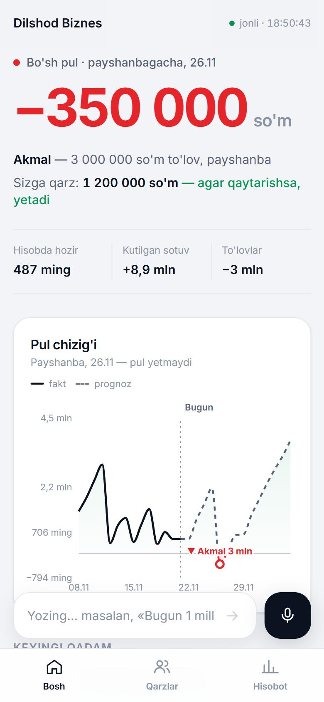
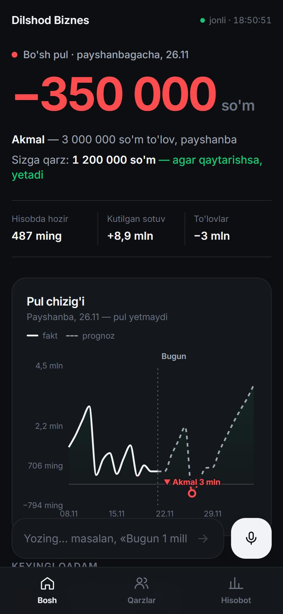
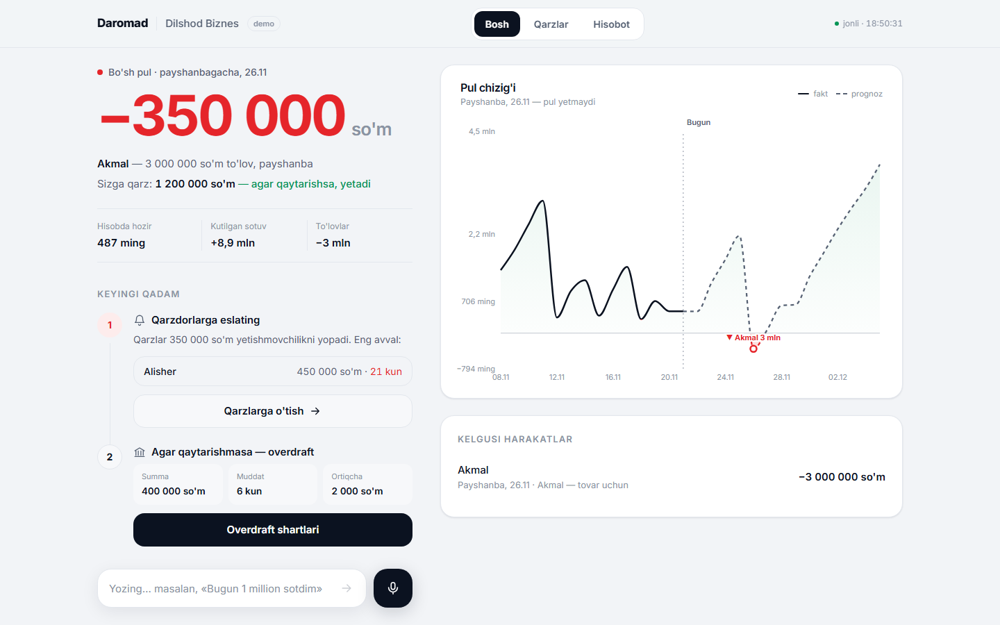
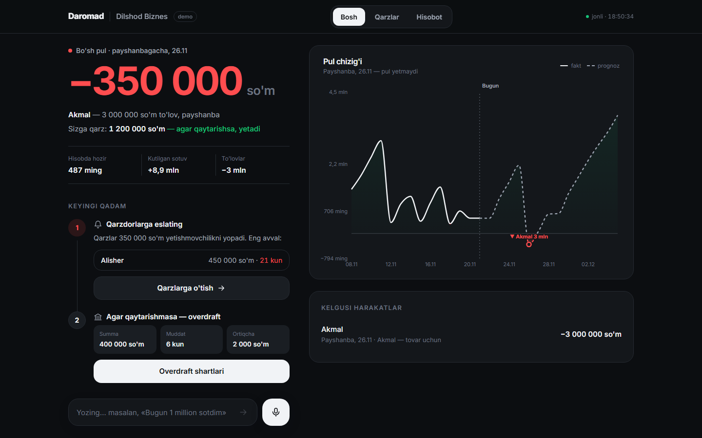

# Daromad

Голосовой финансовый помощник в Telegram для микро- и малого бизнеса в Узбекистане: кафе, мастерские,
сервисы, торговля, оптовики, ИП, самозанятые. Владелец голосом
(узбекский / русский / смесь) говорит, что продал, что потратил, кто взял в долг и какие платежи
предстоят. Бот считает главную цифру — **свободные деньги до следующего платежа** — и
предупреждает о нехватке: сначала предлагает напомнить должникам, потом овердрафт; при излишке — вклад.

**Принцип:** ИИ (Gemini) понимает речь и извлекает данные → **код** считает все цифры → **человек** подтверждает кнопкой.

## Структура

```
backend/
  main.py        FastAPI + бот (aiogram, long polling) в одном процессе
  bot.py         хендлеры Telegram, тексты на узбекском
  ai.py          Gemini: распознавание голоса/текста в JSON, маскирование телефонов, сверка сумм
  uz_numbers.py  детерминированный парсер сумм ("2 million 300 ming", "bir yarim million", "1,5 mln")
  pipeline.py    общий конвейер бота и API: ИИ → валидация → черновики → подтверждение
  logic.py       free_money, forecast, recommendation (только код, без ИИ)
  api.py         REST API /api/* для Mini App
  db.py          SQLite (backend/data/daromad.db)
  seed.py        демо-данные «Dilshod Biznes»
  tests/         pytest
miniapp/         Telegram Mini App «Hisobim»: Vite + React + TypeScript + Tailwind + Recharts
  src/screens/   Bosh (главная), Qarzlar (долги), Hisobot (отчёт), Pay (/pay/:token)
  src/components/ график «Pul chizig'i», шаги 1 → 2, поле ввода с микрофоном, листы подтверждения
  src/lib/       API-клиент, Telegram WebApp, живое обновление, запись голоса в WAV
  vercel.json    SPA-rewrites для деплоя
```

| Мобильная (390px) | Десктоп |
|---|---|
|   | <br> |

## Установка (Windows)

Проект лежит в OneDrive, поэтому виртуальное окружение — **вне OneDrive**, в `C:\venvs\daromad`.

```powershell
py -3.12 -m venv C:\venvs\daromad
```

```powershell
C:\venvs\daromad\Scripts\Activate.ps1
```

```powershell
pip install -r backend\requirements.txt
```

Если PowerShell запрещает запуск скриптов при активации:
`Set-ExecutionPolicy -Scope CurrentUser RemoteSigned` (или вызывайте `C:\venvs\daromad\Scripts\python.exe` напрямую).

## Настройка `.env`

Скопируйте `backend/.env.example` в `backend/.env` и заполните:

| Ключ | Что это |
|---|---|
| `BOT_TOKEN` | токен бота от @BotFather |
| `GEMINI_API_KEY` | ключ Google AI Studio |
| `GEMINI_MODEL` | по умолчанию `gemini-flash-latest`. Для новых ключей Google `*-latest` и `gemini-2.5-flash` недоступны — ставьте `gemini-3.8-flash`. Если модель не найдена (404) или перегружена (503/таймаут 25 с), код сам переходит по цепочке `gemini-3.8-flash` → `gemini-3.5-flash-lite`, а упавшую модель пропускает 5 минут |
| `WEBAPP_URL` | https-адрес Mini App (фаза 2), даёт кнопку-меню «Hisobim»; можно оставить пустым |
| `DEV_SHOP_ID` | бизнес для API без Telegram-заголовка (демо), по умолчанию `1` |

Без `BOT_TOKEN` поднимается только API; без `GEMINI_API_KEY` не работает распознавание (бот отвечает понятной ошибкой).

## Запуск

```powershell
cd backend
```

```powershell
python seed.py --reset
```

```powershell
uvicorn main:app --port 8000
```

`seed.py --reset` идемпотентно пересоздаёт демо-бизнес (#1). Если демо уже привязан к вашему Telegram, привязка сохраняется.
В Telegram: `/start` → «🧪 Demo biznesni ulash» — бот покажет данные seed и нехватку к четвергу.

## Тесты

```powershell
cd backend; python -m pytest -q
```

## Как считается «свободные деньги»

```
свободные = остаток сейчас + ожидаемые продажи − ожидаемые обычные расходы − платежи (pending, срок ≤ горизонт)
            + будущие денежные потоки (срок ≤ горизонт)
```

- остаток = opening_cash + продажи − расходы + возвращённые долги + денежные потоки на сегодня (выдача в долг остаток не меняет);
- денежные потоки (`cash_flows`) — движения вне прибыли: выдача и возврат овердрафта, вклад и его возврат с процентами,
  изъятия владельца (`owner_draw`, ими seed держит историю остатка ≥ 0). Прибыль они не меняют, остаток и прогноз — меняют;
- ожидание на день = среднее за последние 4 таких же дня недели; учитываются дни с завтрашнего по день перед платежом (сегодня — факт, платёж уходит утром);
- аренда (`ijara`) и оплаченные плановые платежи в «обычные» расходы не входят;
- горизонт = ближайший pending платёж, иначе +7 дней;
- долги клиентов в формулу не входят — показываются отдельно (`total_receivable`, `top_debtors`).

## API

Без заголовка `X-Telegram-Init-Data` используется бизнес `DEV_SHOP_ID`. С заголовком подпись проверяется по `BOT_TOKEN`
(стандартный алгоритм Telegram WebApp), бизнес ищется по Telegram user id. Денежные поля в summary/forecast/recommendation округлены до 1000.

```bash
curl localhost:8000/api/summary
curl "localhost:8000/api/forecast?days=14"
curl localhost:8000/api/debts
curl "localhost:8000/api/entries?period=week"
curl localhost:8000/api/recommendation
curl "localhost:8000/api/audit?limit=20"

# распознать текст -> черновики (pending) с id
curl -X POST localhost:8000/api/text -H "Content-Type: application/json" \
  -d '{"text":"Bugun 2 million 300 ming sotdim, Alisher 150 ming qarz oldi, payshanba kuni yetkazib beruvchiga 3 million"}'

# голос (ogg/webm/mp3)
curl -X POST localhost:8000/api/voice -F "audio=@voice.ogg;type=audio/ogg"

# подтвердить / отклонить черновики
curl -X POST localhost:8000/api/entries/confirm -H "Content-Type: application/json" -d '{"ids":[1,2,3]}'
curl -X POST localhost:8000/api/entries/reject  -H "Content-Type: application/json" -d '{"ids":[4]}'

# банковский оффер (демо): принять / отклонить
curl -X POST localhost:8000/api/offers/accept  -H "Content-Type: application/json" -d '{"type":"overdraft","amount":400000}'
curl -X POST localhost:8000/api/offers/decline -H "Content-Type: application/json" -d '{"type":"overdraft","amount":400000}'
```

В PowerShell используйте `curl.exe` вместо `curl`.

`/offers/accept` пересчитывает условия кодом (сумму клиент не может «подкрутить» в стоимость) и пишет денежные потоки:
овердрафт — `+сумма` сегодня и `−(сумма + проценты)` в день возврата; вклад — наоборот. Срок овердрафта считается **от сегодня**:
первый день после платежа, начиная с которого прогноз уже не опускается ниже суммы возврата. Второй овердрафт, пока не погашен
первый, — `409`. Каждое решение пишется в журнал (`offer_accepted` / `offer_declined`). Кнопки оффера в боте идут по тому же пути.

## Mini App (фаза 2)

Одна цифра «Bo'sh pul», график «Pul chizig'i» (факт → «Bugun» → пунктир прогноза, красная зона ниже нуля),
шаги «1. напомнить должникам → 2. овердрафт», ввод голосом или текстом с подтверждением «To'g'ri / Tuzatish»,
долги с напоминаниями, отчёт за неделю / месяц и журнал действий. Данные обновляются каждые 5 секунд и после каждого действия.

Два режима:

- **в Telegram** — приложение шлёт `X-Telegram-Init-Data`, бэкенд проверяет подпись и находит бизнес пользователя;
- **в обычном браузере** — демо-режим (бейдж «demo»), запросы без заголовка, бизнес `DEV_SHOP_ID`.

Микрофон пишет WAV 16 кГц моно. Если браузер или WebView не даёт микрофон (нужен https или localhost), появляется подсказка
«Ovozli xabarni botga yuboring».

### Запуск локально

Нужен Node.js 20+. Бэкенд должен работать на `:8000` (см. «Запуск»).

```powershell
npm --prefix miniapp install
```

```powershell
npm --prefix miniapp run dev
```

Откройте http://localhost:5173. Адрес API берётся из `VITE_API_URL` (по умолчанию `http://localhost:8000`, пример — `miniapp/.env.example`).

```powershell
npm --prefix miniapp run build
```

### Бэкенд наружу: cloudflared

Telegram открывает Mini App только по https, и приложению на Vercel нужен публичный адрес API. Быстрый туннель
(установка: `winget install Cloudflare.cloudflared`):

```powershell
cloudflared tunnel --url http://localhost:8000
```

Он печатает адрес вида `https://<random>.trycloudflare.com` — это ваш `VITE_API_URL`. Адрес меняется при каждом запуске
быстрого туннеля; для постоянного адреса нужен именованный туннель в аккаунте Cloudflare. CORS на бэкенде открыт.

### Деплой на Vercel

1. Vercel → **Add New → Project** → импортируйте репозиторий.
2. **Root Directory**: `miniapp` (framework Vite определится сам, `vercel.json` уже содержит SPA-rewrites, поэтому `/pay/<token>` и вкладки открываются напрямую).
3. **Environment Variables**: `VITE_API_URL` = адрес туннеля (без `/` в конце).
4. **Deploy**. При смене адреса туннеля обновите переменную и сделайте **Redeploy** — Vite вшивает её при сборке.

Или из консоли: `npx vercel --cwd miniapp` (переменную добавить через `npx vercel env add VITE_API_URL`).

### Подключение к боту

1. В `backend/.env` укажите `WEBAPP_URL=https://<ваш-проект>.vercel.app` и перезапустите бэкенд — у бота появится кнопка «Hisobim».
2. Кнопка меню в @BotFather: `/mybots` → ваш бот → **Bot Settings** → **Menu Button** → **Configure menu button** →
   отправьте URL Mini App → название `Hisobim`.
3. Откройте бота в Telegram и нажмите «Hisobim». Если бизнес ещё не подключён, сначала `/start` → «🧪 Demo biznesni ulash».

Ссылки на эндпоинты напоминаний (`/api/debts/{id}/remind`) и оплаты (`/api/pay/{token}`) Mini App вызывает, но в бэкенде их пока нет:
на `404` приложение показывает демо-превью SMS и демо-страницу оплаты (`/pay/demo`), ничего не отправляя.

## Не в этой фазе

Распознавание фото (фаза 3), реальные SMS / платежи / банк, эндпоинты напоминаний и оплаты по ссылке.
